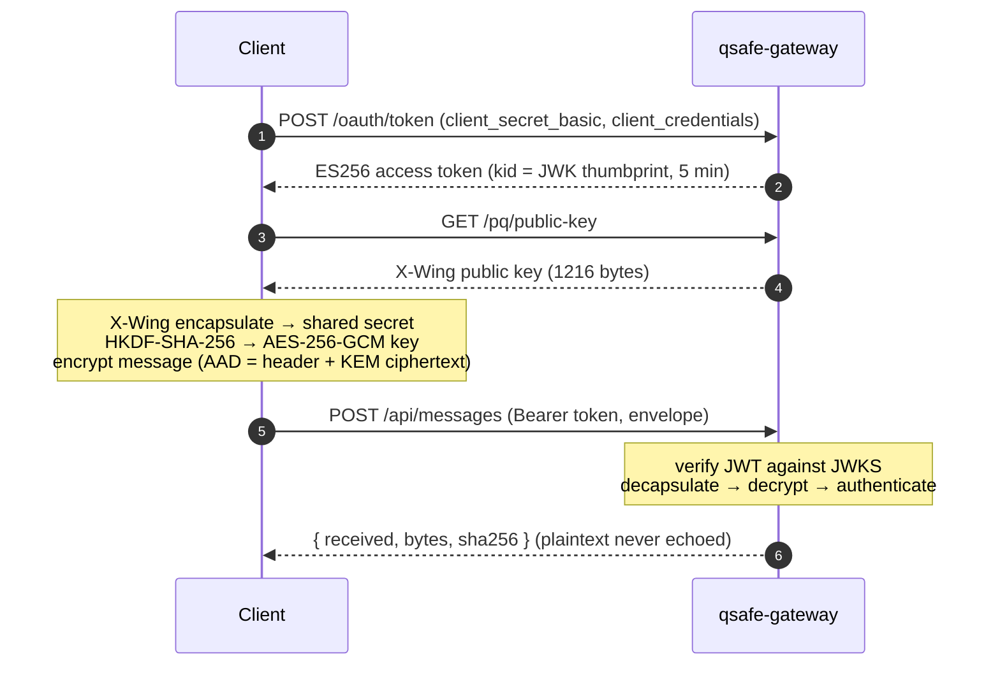
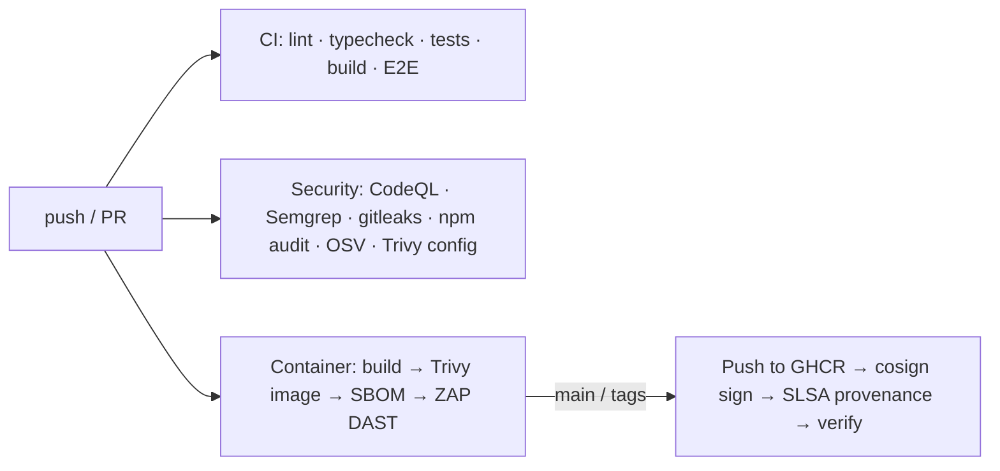

# qsafe-gateway

[](https://github.com/poke1896/qsafe-gateway/actions/workflows/ci.yml)
[](https://github.com/poke1896/qsafe-gateway/actions/workflows/security.yml)
[](https://github.com/poke1896/qsafe-gateway/actions/workflows/codeql.yml)
[](https://github.com/poke1896/qsafe-gateway/actions/workflows/container.yml)
[](https://scorecard.dev/viewer/?uri=github.com/poke1896/qsafe-gateway)

A small, production-minded API that shows **DevSecOps end to end**: a hardened OAuth 2.0 token service
(ES256 JWTs, rotating JWKS, revocation) plus **hybrid post-quantum encryption** (X-Wing = ML-KEM-768 + X25519),
shipped through a CI/CD pipeline that scans, signs and attests every container image.

## Interactive playground

Run the server and open `http://localhost:8080/`: request a token and inspect it, verify it against the JWKS,
encrypt a message **post-quantum in your browser** (WebCrypto + X-Wing) and watch the server decrypt it, then fire
six real attacks at the API (`alg: none`, HS256 key confusion, payload tampering, missing scope, ciphertext and
KEM tampering) and see each one blocked. The page is served with its own strict CSP (no inline script) and uses a
deliberately public, low-privilege sandbox client.

## What it demonstrates

| Area | Implementation |
|---|---|
| **Tokens** | OAuth 2.0 client credentials (RFC 6749), JWT access tokens in RFC 9068 profile (`typ: at+jwt`), ES256 only |
| **Key management** | JWKS (RFC 7517) with RFC 7638 thumbprint `kid`s, zero-downtime rotation with a grace window, private keys never exported |
| **Token hardening** | Algorithm allowlist (blocks `alg: none` and HS256/ES256 key confusion), `iss`/`aud`/`typ`/`exp`/`nbf` checks, clock tolerance, size limit, `jti` revocation (RFC 7009) |
| **Post-quantum crypto** | X-Wing hybrid KEM (draft-connolly-cfrg-xwing-kem) + HKDF-SHA-256 + AES-256-GCM with header-bound AAD |
| **App security** | Browser and server crypto implemented independently and tested for byte-level interoperability, constant-time client auth, brute-force rate limiting, strict security headers (CSP, HSTS), body size limits, fail-fast config validation, no error oracles |
| **Pipeline** | Lint (incl. `eslint-plugin-security`), typecheck, tests with coverage gate, E2E demo |
| **SAST / SCA / secrets** | CodeQL (security-extended), Semgrep (OWASP, JWT, Node), npm audit + registry signatures, OSV-Scanner, gitleaks on full history, Dependency Review on PRs |
| **Container** | Multi-stage build, distroless non-root runtime, digest-pinned base images, Trivy config + image scans, SPDX SBOM, OWASP ZAP DAST against the running container |
| **Supply chain** | Every action pinned to a commit SHA, `harden-runner`, least-privilege `GITHUB_TOKEN`, Sigstore keyless signing (cosign), SLSA build provenance, OpenSSF Scorecard, Dependabot with a 7-day cooldown |

## Architecture





## Why hybrid post-quantum encryption?

Data encrypted today with classical key exchange (ECDH) can be recorded now and decrypted once a large
quantum computer exists (**"harvest now, decrypt later"**). ML-KEM (FIPS 203) resists that, but it is young.
**X-Wing** combines both: the derived key stays secret as long as *either* ML-KEM-768 *or* X25519 is unbroken,
the same hybrid approach already used in TLS by major browsers. The KEM output feeds HKDF-SHA-256 (bound to the
protocol version and recipient key id) and AES-256-GCM, whose AAD covers the envelope header and KEM ciphertext,
so any edited, swapped or replayed-under-another-key field fails authentication.

## Endpoints

| Method | Path | Auth | Purpose |
|---|---|---|---|
| GET | `/health` | none | Liveness |
| GET | `/.well-known/oauth-authorization-server` | none | RFC 8414 metadata |
| GET | `/.well-known/jwks.json` | none | Public signing keys (active + in-grace) |
| POST | `/oauth/token` | client secret (Basic) | Issue access token |
| POST | `/oauth/revoke` | client secret (Basic) | Revoke own token (RFC 7009) |
| GET | `/api/me` | `profile:read` | Token introspection for the caller |
| GET | `/pq/public-key` | none | X-Wing public key |
| POST | `/api/messages` | `messages:write` | Receive a post-quantum encrypted envelope |
| POST | `/admin/keys/rotate` | `keys:rotate` | Rotate the signing key |

## Run it

```bash
npm ci
npm run dev          # http://localhost:8080 (development uses documented dev-only secrets)
npm run demo         # token → PQ public key → encrypt locally → server decrypts
npm run test:coverage
```

With Docker (read-only filesystem, all capabilities dropped):

```bash
docker build -t qsafe-gateway .
docker run --rm -p 8080:8080 --read-only --cap-drop ALL --security-opt no-new-privileges \
  -e DEMO_READER_SECRET="$(openssl rand -hex 24)" -e DEMO_ADMIN_SECRET="$(openssl rand -hex 24)" \
  -e PLAYGROUND_SECRET="$(openssl rand -hex 24)" qsafe-gateway
```

Verify a published image was built by this repository's pipeline:

```bash
cosign verify ghcr.io/poke1896/qsafe-gateway:main \
  --certificate-oidc-issuer https://token.actions.githubusercontent.com \
  --certificate-identity-regexp '^https://github.com/poke1896/qsafe-gateway/.github/workflows/container.yml@'
gh attestation verify oci://ghcr.io/poke1896/qsafe-gateway:main --owner poke1896
```

## Configuration

All settings are validated at startup (see [`.env.example`](.env.example)). Production refuses to start without
real client secrets, and rejects a key grace window shorter than the token lifetime (which would break live tokens
on rotation). For multi-instance or serverless deployments, generate persistent keys with `npm run keys:generate`
and store them in a secret manager.

## Security model

See [docs/THREAT_MODEL.md](docs/THREAT_MODEL.md) for the STRIDE analysis and [SECURITY.md](SECURITY.md) for reporting.

**Known limitations (by design, for a single-instance reference):** keys, rate limits and the revocation list live
in memory. A real deployment would keep private keys in a KMS/HSM and back rate limiting and revocation with a
shared store such as Redis.

## License

MIT © Adrián Valverde Elizondo
